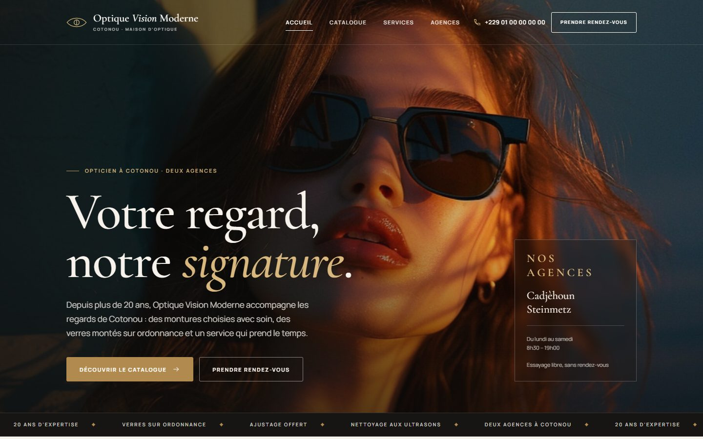
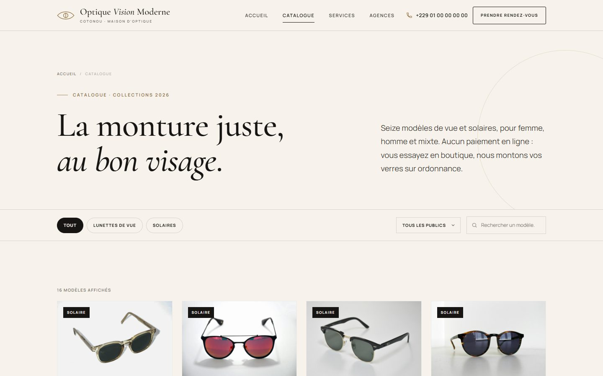
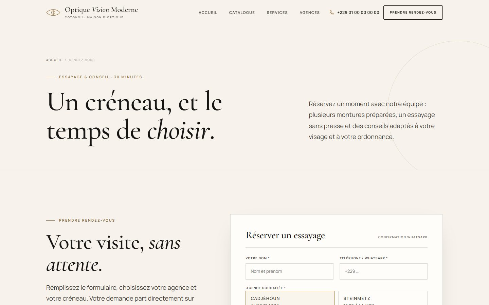
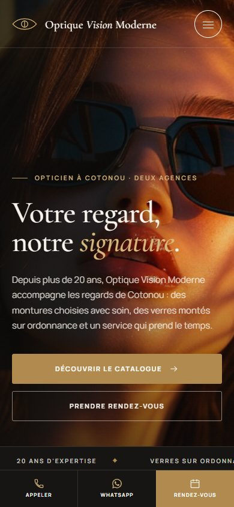

# Optique Vision Moderne — Site vitrine

> Site vitrine pour **Optique Vision Moderne**, opticien à Cotonou (Bénin) depuis plus de 20 ans.
> Catalogue de montures, services, deux agences et prise de rendez-vous via WhatsApp — **sans paiement en ligne**.

[](https://github.com/T0b0i7/optique-vision-moderne/actions/workflows/pages.yml)
[](https://github.com/T0b0i7/optique-vision-moderne/commits/main)

**Démos en ligne :**
- GitHub Pages : https://t0b0i7.github.io/optique-vision-moderne/
- Vercel : https://optique-vision-moderne.vercel.app



## Pourquoi ce site

Un opticien au Bénin ne vend pas des lunettes comme une boutique en ligne : les verres sont réalisés **sur ordonnance**, essayés et ajustés en boutique. Ce site ne cherche donc pas à encaisser un paiement, mais à :

1. **rassurer** dès les premières secondes (20 ans d'expertise, deux adresses, savoir-faire) ;
2. **montrer les collections** avant le déplacement ;
3. **créer un contact immédiat** par WhatsApp ou téléphone ;
4. **faciliter la visite** avec des horaires, itinéraires et un créneau d'essayage réservable.

## Fonctionnalités

- **Accueil éditorial** : hero plein écran, maison, chiffres clés, collections, sélection, services, citation, agences, appel à l'action.
- **Catalogue filtrable** : 16 modèles, filtres Vue / Solaires, public, recherche sans accents, compteur, état vide.
- **Fiche produit en modale** : photo, description, forme, matière, public et WhatsApp contextualisé.
- **Prise de rendez-vous** : agence, date et créneau → message WhatsApp pré-rempli, aucune donnée stockée.
- **Deux agences** : horaires, téléphone, itinéraires Google Maps et cartes intégrées.
- **Mobile-first** : menu plein écran, barre d'actions Appeler / WhatsApp / RDV, images lazy.
- **Qualité** : SEO local (JSON-LD, Open Graph), accessibilité (skip link, focus, aria, reduced motion), zéro dépendance JS.

## Aperçu

| Catalogue filtrable | Prise de rendez-vous |
| --- | --- |
|  |  |

<p align="center"></p>

## Stack & structure

HTML5, CSS3 (custom properties, grid, clamp) et JavaScript natif. Aucun framework, aucun build obligatoire, aucune base de données.

```text
.
├── index.html                 # Accueil
├── catalogue.html             # 16 montures + filtres + modale
├── services.html              # Prestations, parcours, verres, FAQ
├── agences.html               # Cadjèhoun & Steinmetz + cartes
├── rendez-vous.html           # Formulaire → WhatsApp
├── assets/
│   ├── css/style.css          # Design system responsive
│   ├── js/main.js             # Filtres, modale, formulaire, menu
│   └── img/                   # Photos + favicon
├── docs/screenshots/          # Captures pour ce README
├── _tools/                    # Scripts internes de génération
├── .github/workflows/pages.yml
├── vercel.json
└── robots.txt
```

## Lancer en local

Ouvrez simplement `index.html` dans un navigateur. Pour tester avec un vrai serveur HTTP :

```bash
npx serve .
# ou
python -m http.server 8080
```

Puis ouvrez `http://localhost:8080` (ou le port indiqué).

## Personnalisation

### 1. Téléphone / WhatsApp — **obligatoire**

Le numéro actuellement présent est un **placeholder de démonstration** (`+229 01 00 00 00 00`). Mettez à jour tout le site en une commande :

```bash
node _tools/set-phone.js 22997000000 "+229 97 00 00 00"
```

Le script modifie les pages HTML et `assets/js/main.js`. Vous pouvez aussi éditer l'objet `CONFIG` dans `assets/js/main.js` (lignes 16–20).

### 2. Horaires et adresses

Horaires actuels : lundi–vendredi 8h30–19h00, samedi 9h00–18h00, dimanche fermé. À confirmer avec le gérant dans `index.html`, `agences.html` et le JSON-LD de `index.html`.

### 3. Catalogue

Chaque modèle est une carte dans `catalogue.html` avec `data-name`, `data-material`, `data-desc`, `data-cat`, `data-gender`, `data-shape`. Dupliquez une carte, changez l'image et les données. Les 4 modèles de l'accueil sont dans `index.html` (section « Sélection de la maison »).

### 4. Photos

Les visuels de `assets/img/` proviennent du modèle scrapé et servent de **démonstration**. Remplacez-les par les photos réelles (mêmes noms de fichiers) : format paysage 3:2 pour les montures, portrait 4:5 pour les éditoriaux. Crédit photos à vérifier avant publication commerciale.

### 5. Google Maps

Les liens d'itinéraire et les iframes utilisent une recherche par nom. Remplacez-les par les fiches Google Business exactes des deux agences si nécessaire.

## Déploiement

### GitHub Pages (automatique)

Le workflow [`.github/workflows/pages.yml`](.github/workflows/pages.yml) publie le site à chaque push sur `main` :

1. stage des fichiers statiques dans `dist/` ;
2. upload de l'artefact Pages ;
3. déploiement.

**Site :** https://t0b0i7.github.io/optique-vision-moderne/

Paramétrage déjà appliqué : `Settings → Pages → Source : GitHub Actions`. Pour relancer manuellement :

```bash
gh workflow run pages.yml
gh run watch
```

### Vercel (production)

Le projet est déjà lié et déployé sur :

**https://optique-vision-moderne.vercel.app**

Pour redéployer après une modification :

```bash
vercel deploy --prod --yes
```

Ou importez le dépôt sur [vercel.com/new](https://vercel.com/new) : framework **Other**, build command vide, output directory `.` — le site est 100 % statique.

### Domaine personnalisé

Dans GitHub Pages (`Settings → Pages → Custom domain`) ou Vercel (`Settings → Domains`), ajoutez le domaine de l'opticien, puis créez l'enregistrement DNS demandé. Mettez à jour les URL canoniques/Open Graph si vous les ajoutez.

## Vérifications

- Catalogue : 12 modèles « Vue », 4 « Solaires » ; les modèles mixtes apparaissent aussi dans les filtres Femme/Homme.
- Modale : ouverture clavier, fermeture `Échap`, focus rendu au bouton.
- Rendez-vous : dates générées hors dimanche, message WhatsApp complet (nom, agence, motif, date, créneau).
- Menu mobile : ouverture/fermeture, verrouillage du scroll, `aria-expanded`.
- Pages testées en 1440 px et 390 px, sans erreur console ; images et liens internes vérifiés.

## Avant une mise en production réelle

- [ ] Remplacer le numéro WhatsApp/téléphone placeholder (`_tools/set-phone.js`).
- [ ] Confirmer les horaires des deux agences auprès du gérant.
- [ ] Remplacer les photos de démonstration par les visuels réels (boutique, équipe, montures).
- [ ] Valider les modèles, matières et disponibilités du catalogue.
- [ ] Vérifier les fiches Google Business et les liens d'itinéraire.
- [ ] Ajouter les réseaux sociaux réels (Facebook/Instagram) si disponibles.
- [ ] Mettre à jour les mentions légales si le site est exploité commercialement.
- [ ] Ajouter un domaine personnalisé et l'URL canonique.

## Limites assumées

- **Pas de panier, pas de prix, pas de paiement** : choix volontaire pour un opticien béninois. Tout passe par WhatsApp et la boutique.
- **Pas de back-office** : le catalogue se modifie dans le HTML. `_tools/` fournit des scripts de génération, mais aucun CMS.
- **Dépendances externes** : Google Fonts, Google Maps et WhatsApp. En cas de coupure réseau, les polices de secours et les liens téléphone restent fonctionnels.
- **Images de démonstration** : issues d'un template, à remplacer avant toute communication commerciale.

## Roadmap possible

- Version anglaise pour les visiteurs internationaux.
- Formulaire de contact avec envoi d'e-mail (Formspree/Resend) en complément de WhatsApp.
- Galerie « avant / après » ou conseils morphologie.
- Blog local (choisir ses verres, entretenir ses lunettes, protection UV à Cotonou).
- Tableau de bord simple pour modifier les modèles sans toucher au code.

## Licence & crédits

Projet réalisé pour la démonstration commerciale d'**Optique Vision Moderne**. Le code (HTML/CSS/JS) peut être adapté et réutilisé pour ce client. Les photos proviennent du template « Eyewear » scrapé et ne sont pas libres de droits : **remplacez-les par des visuels appartenant à l'opticien** avant publication.

Polices : [Cormorant Garamond](https://fonts.google.com/specimen/Cormorant+Garamond) et [Manrope](https://fonts.google.com/specimen/Manrope), sous licence SIL Open Font License.


